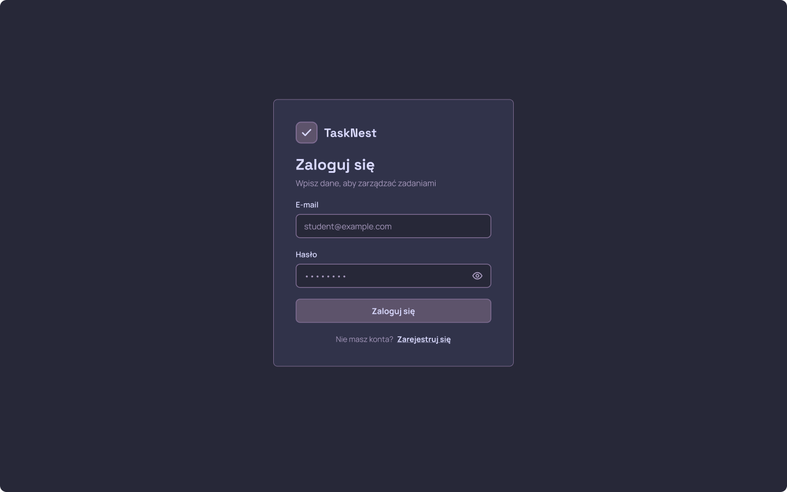
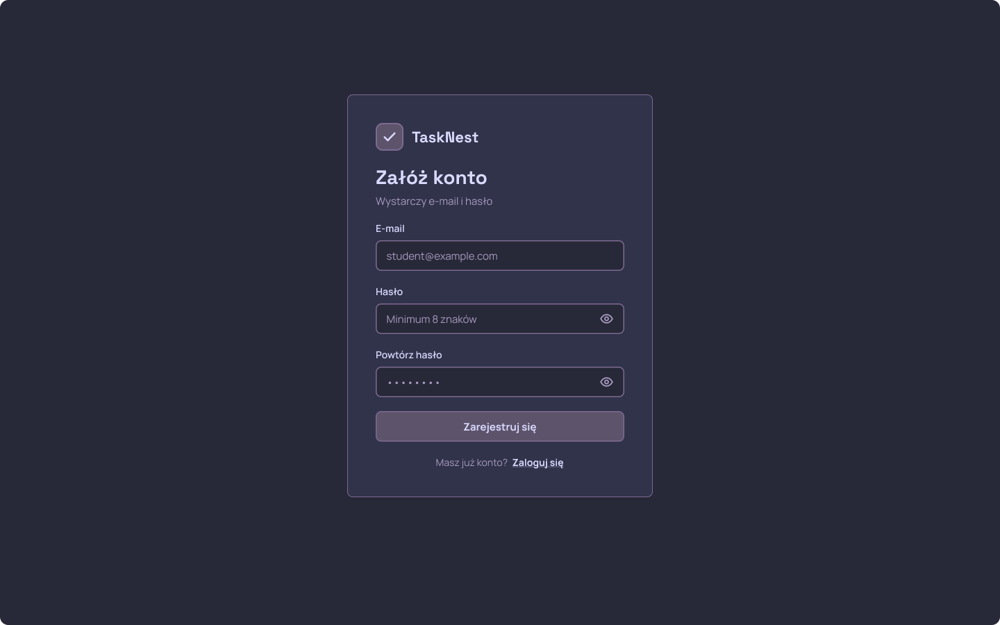
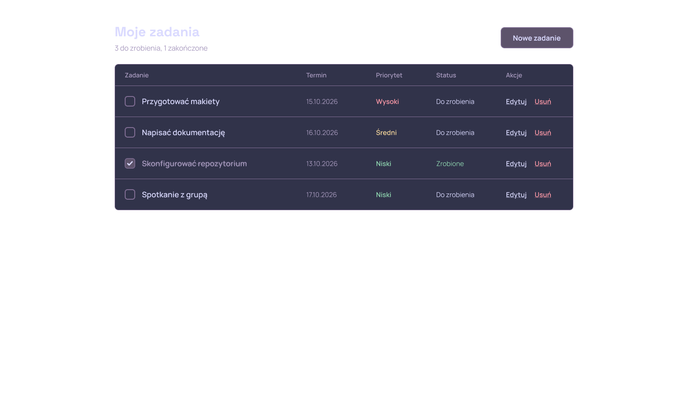
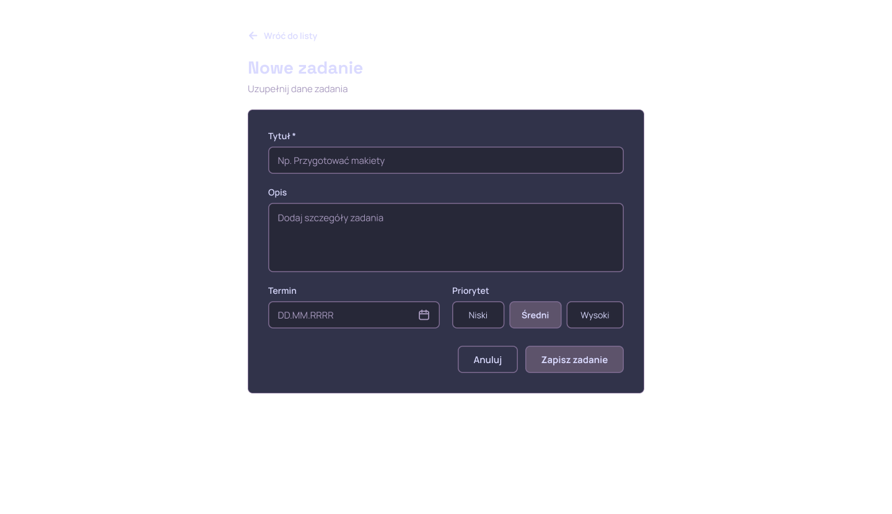
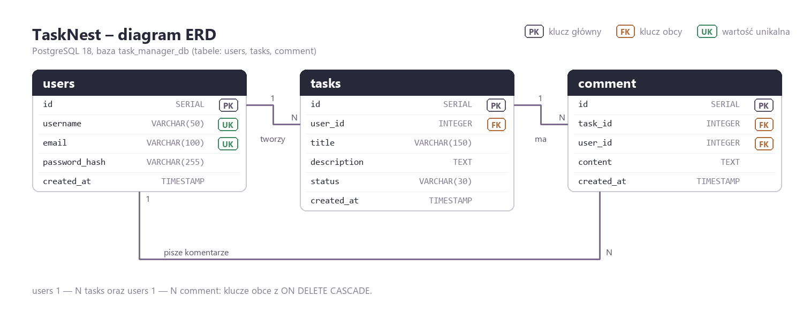
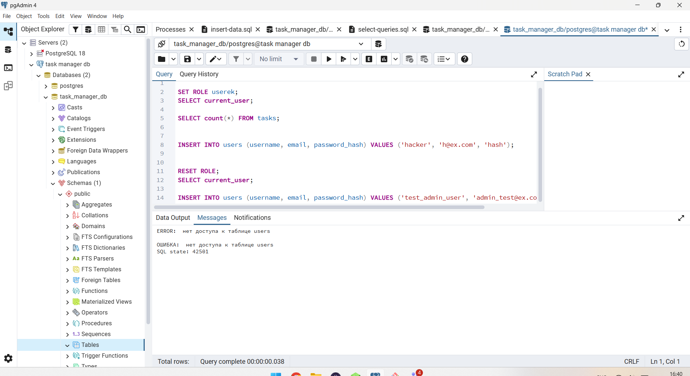

<div align="center">


# TaskNest

**Aplikacja webowa do zarządzania zadaniami (menedżer zadań)**

Praktyczna praca — Git · baza danych · administracja · dokumentacja


</div>

---

## O projekcie

**TaskNest** to projekt aplikacji webowej do zarządzania zadaniami. Użytkownik zakłada konto,
loguje się, a następnie prowadzi listę swoich zadań: dodaje, edytuje i usuwa zadania
(tytuł, opis, termin, priorytet, status). Dane przechowywane są w bazie **PostgreSQL**.

W ramach pracy praktycznej wykonane zostały cztery obszary:

| Obszar | Co zawiera | Gdzie |
|---|---|---|
| **Git** | praca na gałęziach, Pull Requests, `.gitignore`, CI w GitHub Actions | [`.github/`](.github) |
| **Baza danych** | 3 tabele, diagram ERD, skrypty `schema.sql`, `insert-data.sql`, `select-queries.sql` | [`database/`](database) |
| **Administracja** | instrukcje zarządzania użytkownikami i uprawnieniami oraz backupu/restore | [`docs/`](docs) |
| **Dokumentacja** | ten plik README, dokumentacja techniczna, makiety, prezentacja | [`docs/`](docs) · [`design/`](design) |

## Makiety ekranów

Interfejs zaprojektowany w Figmie (ciemny motyw, prosty, „ścisły” styl) — szczegóły w
[`docs/design.md`](docs/design.md), projekt: **[TaskNest – Design (Figma)](https://www.figma.com/design/La47nnBjcppw2h4ttijSLB)**.

<p align="center">
  
  
  
  
</p>

## Technologie

| Warstwa | Technologia | Zastosowanie |
|---|---|---|
| Baza danych | PostgreSQL 18, pgAdmin 4 | przechowywanie użytkowników, zadań i komentarzy |
| Interfejs | HTML5, CSS3, JavaScript | ekrany aplikacji (logowanie, lista zadań, formularze) |
| Backend | PHP *(planowany)* | logika aplikacji i dostęp do bazy |
| Dokumentacja | Markdown | README i dokumentacja w katalogu `docs/` |
| Praca z kodem | Git, GitHub, GitHub Actions | gałęzie, Pull Requests, sprawdzanie kodu (CI) |
| Projektowanie | Figma | makiety i projekt interfejsu |

## Baza danych

Diagram ERD (szczegółowy opis tabel: [`docs/database.md`](docs/database.md)):



Skrypty SQL:

| Plik | Przeznaczenie |
|---|---|
| [`database/schema.sql`](database/schema.sql) | tworzy tabele `users`, `tasks`, `comment` z kluczami i indeksami |
| [`database/insert-data.sql`](database/insert-data.sql) | wgrywa po 5 przykładowych rekordów do każdej tabeli |
| [`database/select-queries.sql`](database/select-queries.sql) | przykładowe zapytania: sortowanie, filtr, `GROUP BY`, `JOIN` |

Szybkie odtworzenie bazy (Query Tool w pgAdmin 4):

```sql
CREATE DATABASE task_manager_db;
-- następnie otwórz i uruchom po kolei: schema.sql, insert-data.sql, select-queries.sql
```

## Administracja bazą danych

- **[Zarządzanie użytkownikami i uprawnieniami](docs/database-roles.md)** — utworzenie konta
  `userek` (rola tylko do odczytu), nadanie praw `CONNECT` / `USAGE` / `SELECT` oraz test,
  w którym `SELECT` działa, a `INSERT` jest zablokowany (błąd `42501`):

  

- **[Backup i restore w pgAdmin 4](docs/backup-restore.md)** — wykonanie kopii zapasowej,
  symulacja awarii (`DROP TABLE users CASCADE`) i odtworzenie danych, a także zasada 3-2-1
  dla przechowywania kopii.

## Struktura projektu

```
Practical-work/
├── .github/workflows/ci.yaml    # CI: html-validate, stylelint, node --check
├── backend/                     # backend aplikacji (PHP) — planowany
├── database/                    # skrypty SQL i diagram ERD
│   ├── schema.sql
│   ├── insert-data.sql
│   ├── select-queries.sql
│   └── erd.png
├── design/                      # makiety ekranów (eksport z Figmy)
├── docs/                        # dokumentacja techniczna
│   ├── database.md
│   ├── database-roles.md
│   ├── backup-restore.md
│   ├── design.md
│   └── screenshots/
├── frontend/                    # warstwa frontendowa (HTML/CSS/JS)
├── tests/                       # miejsce na testy — planowane
├── .gitignore
└── README.md
```

## Git i CI

- Każda zmiana powstawała na osobnym branchu i była scalana przez **Pull Request**
  (łącznie 15 PR-ów w repozytorium).
- Plik [`.gitignore`](.gitignore) wyklucza pliki konfiguracji lokalnej, katalogi `bin/`,
  `obj/`, `node_modules/` oraz kopie bazy z danymi.
- **GitHub Actions** ([`ci.yaml`](.github/workflows/ci.yaml)) po każdym pushu i Pull
  Requeście sprawdza: poprawność HTML (`html-validate`), składnię CSS (`stylelint`)
  i składnię JavaScript (`node --check`).

## Dokumentacja

| Dokument | Zawartość |
|---|---|
| [`docs/database.md`](docs/database.md) | opis bazy: ERD, tabele, relacje, skrypty, normalizacja |
| [`docs/database-roles.md`](docs/database-roles.md) | użytkownicy i uprawnienia w PostgreSQL |
| [`docs/backup-restore.md`](docs/backup-restore.md) | kopia zapasowa i odtworzenie bazy |
| [`docs/design.md`](docs/design.md) | projekt interfejsu: makiety, paleta, kontrast, czcionki |
| [`docs/prezentacja/TaskNest-prezentacja.pptx`](docs/prezentacja/TaskNest-prezentacja.pptx) | prezentacja projektu |

## Jak uruchomić

1. **Baza danych** — utwórz bazę `task_manager_db` w pgAdmin 4 i uruchom po kolei skrypty
   `database/schema.sql`, `database/insert-data.sql`, `database/select-queries.sql`.
2. **Interfejs** — otwórz plik `frontend/index.html` w przeglądarce.

## Status i plan rozwoju

- [x] Makiety i projekt interfejsu (Figma, `design/`, `docs/design.md`)
- [x] Baza danych: struktura, dane przykładowe, zapytania (`database/`)
- [x] Administracja bazą: uprawnienia oraz backup/restore (`docs/`)
- [x] Konfiguracja repozytorium i CI (GitHub Actions)
- [ ] Backend (PHP) i podłączenie interfejsu do bazy
- [ ] Testy (`tests/`)

---

<div align="center">

Autor: [daggermvpp-boop](https://github.com/daggermvpp-boop) · 4. klasa technikum · 2026

</div>
